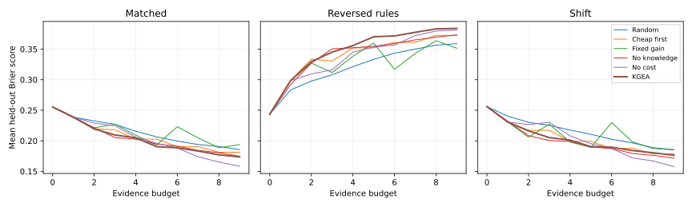
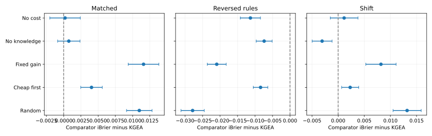

# When knowledge fails: AI-based data acquisition for digital transformation assessment

Short communication research draft for Knowledge-Based Systems

## Abstract
Enterprise assessment requires decisions about which costly evidence to collect next. We study a knowledge-guided evidence acquisition policy that combines posterior capability uncertainty, nonlinear prediction sensitivity and acquisition cost. A controlled simulation compares six policies over ten budgets in twenty independent replications. All policies share a logistic predictor trained on complete synthetic observations. Three test conditions distinguish matched assumptions, reversed outcome relationships and shifted capability distributions. Under matched assumptions, the proposed policy achieves a mean integrated Brier score of 0.2029, compared with 0.2139 for random acquisition. Under reversed relationships, its score deteriorates to 0.3495, compared with 0.3217 for random acquisition. Under capability shift, removing knowledge from acquisition improves the score from 0.2015 to 0.1985. These results establish a conditional mechanism rather than general superiority: informative measurements can amplify errors when the predictive knowledge is invalid. The study motivates knowledge auditing before evidence collection is automated in enterprise decision support. Outcomes and costs are synthetic, and digital transformation readiness is not independently validated.

Keywords: Artificial intelligence; Data acquisition; Knowledge-based systems; Digital transformation; Innovation; Decision support

## 1. Introduction
Digital transformation assessments impose an information burden on organizations. Evidence about technical foundations, governance, innovation and execution may require different amounts of staff effort. The decision about what to measure next therefore belongs within the decision-support problem. For entrepreneurial organizations, a limited assessment budget makes this trade-off relevant, although the present study does not empirically distinguish startups from established firms.

Active feature acquisition already offers methods for sequential measurement selection. Mutual-information approaches [1] and conditional-information estimation [2] provide established alternatives to static selection. A recent survey organizes this broader literature [3]. Our contribution is narrower: an auditable sensitivity heuristic and a controlled demonstration of its vulnerability to incorrect capability relationships. We ask whether benefits under matched assumptions survive outcome reversal and capability shift. We do not claim that the acquisition problem itself is novel.

## 2. Method
Each simulated organization has four latent capabilities z drawn independently from standard normal distributions. Twelve indicators comprise three measurements per capability: x_j = z_g + epsilon_j, with independent Gaussian errors of standard deviations (1.2, 0.7, 0.4). The corresponding acquisition costs are (1, 2, 3), repeated across capabilities. These parameters represent an explicitly assumed measurement system, not empirical organizational estimates.

Given observed indicators S_g, posterior variance and mean are v_g = (1 + sum_{j in S_g} 1/sigma_j^2)^(-1) and mu_g = v_g sum_{j in S_g} x_j/sigma_j^2. Unobserved values contribute nothing. A regularized logistic classifier uses four posterior means, min(mu_0, mu_1, mu_3), and mu_2 mu_3. Training uses fully observed training indicators; partial observations are supplied only during acquisition evaluation. This mismatch is shared by every policy and is an explicit limitation.

The policy selects an affordable unrevealed indicator maximizing A_j = (d f(mu)/d mu_g)^2 v_g^2 / [(v_g + sigma_j^2)c_j], where f is the fitted logit. This is a local variance-reduction proxy, not exact information gain. Derivatives are analytic. At bottleneck ties, the smallest indexed capability receives the derivative; this convention is consequential at the initial equal-mean state and should be examined in future work. Each acquisition updates posterior means and variances until no indicator is affordable.

Comparators are random affordable selection, cheapest first, fixed prior sensitivity per cost, the policy without nonlinear acquisition sensitivity, and the policy without cost normalization. All retain the same nonlinear classifier. Thus the no-knowledge comparator is an acquisition ablation, not a wholly knowledge-free model.

## 3. Experiments
Twenty seeds generate independent training sets of 2,000 observations. The matched outcome is Bernoulli with probability sigmoid(0.2 + 0.8z_0 + 0.7z_1 + 0.4z_2 + 0.9z_3 + 1.4min(z_0,z_1,z_3) + 0.8z_2z_3). Labels are sampled from latent capabilities, not obtained by thresholding observed inputs. Nevertheless, the deliberately aligned simulator favors the proposed representation and cannot establish external validity.

For each seed, three held-out sets of 500 observations are drawn. Matched retains the training mechanism. Reversed rules negates both nonlinear outcome terms while leaving the trained classifier fixed. Shift changes capability means to (0.4,-0.5,0.3,-0.2) and standard deviations to (1.5,0.6,1.2,0.8), retaining the outcome equation. Reversal therefore represents concept shift; Shift represents covariate shift. Neither is an external dataset.

Each policy is evaluated afresh at integer budgets zero through nine on the same held-out observations. The primary endpoint integrates Brier score by the trapezoidal rule and divides by nine. Lower is better. Table 1 reports means and standard deviations across seeds. Table 2 reports paired comparator-minus-KGEA differences with unadjusted Student-t 95% intervals across seeds. These exploratory intervals are not multiplicity-corrected hypothesis tests. Twenty seeds describe Monte Carlo repeatability, not independent organizational populations. Built-in checks verify hidden-value invariance of posterior estimates, empty-evidence priors, zero-budget behavior and budget compliance.

## 4. Results
Table 1 and Figure 1 show that KGEA has the lowest mean integrated Brier score under matched assumptions (0.2029). Its improvement over random acquisition is 0.0110. Differences from no cost (0.2031) and no knowledge (0.2037) are small; a blanket claim that every component is essential would be unjustified.

Under reversed outcome relationships, KGEA records 0.3495 versus 0.3217 for random selection. Acquiring measurements targeted by an incorrect predictor can worsen prediction quality. This result does not isolate acquisition-policy robustness from classifier misspecification: both depend on the fixed trained model. The shared-classifier design isolates policy differences within that misspecified system.

Under capability shift, no knowledge achieves 0.1985, outperforming KGEA at 0.2015. Figure 2 and Table 2 expose these changes in paired relative performance. The practical implication is conditional: audit the validity of capability dependencies before using them to prioritize evidence. More targeted measurement is not equivalent to more reliable decisions.

## 5. Limitations and conclusion
The experiment contains no observed enterprise innovation records, validated readiness construct, monetary costs, nonresponse model or stakeholder study. Equal treatment of hypothetical capability families does not establish fairness across firms. The comparison excludes strong learned acquisition methods [1,2], and the heuristic's deterministic tie convention requires sensitivity analysis. Predictors trained using partial observations and uncertainty integration could change the findings. A future validation must independently measure readiness, estimate collection costs, compare learned policies and test across sectors.

This short communication contributes a reproducible stress test of knowledge-guided evidence collection. Improvements under aligned assumptions coexist with failure under knowledge mismatch. The result supports conditional use and further validation, rather than deployment or state-of-the-art claims.

## Data and code availability
All observations are simulated. Source and numerical outputs: https://github.com/Sirivennela47/kgea-digital-readiness. Execute run.py with the pinned requirements to regenerate both figures and both tables.

## Declarations
Author details, institutional address, correspondence, CRediT contributions, funding and competing interests require author confirmation before submission. ChatGPT (OpenAI) assisted study design, code, experimental analysis and drafting; human authors must verify the work and accept responsibility for the final manuscript.

## References
[1] I.C. Covert, W. Qiu, M. Lu, N.Y. Kim, N.J. White, S.-I. Lee, Learning to maximize mutual information for dynamic feature selection, Proceedings of Machine Learning Research 202 (2023) 6424–6447. https://proceedings.mlr.press/v202/covert23a.html
[2] S. Gadgil, I. Covert, S.-I. Lee, Estimating conditional mutual information for dynamic feature selection, International Conference on Learning Representations (2024). https://proceedings.iclr.cc/paper_files/paper/2024/hash/9682490bedc064aba8aac1ab3f703507-Abstract-Conference.html
[3] L. Aronsson, A. Rahbar, M.H. Chehreghani, A survey on active feature acquisition strategies, Proceedings of IJCAI (2026). https://ijcai.org/proceedings/2026/860

Table 1. Integrated Brier means and standard deviations.

| scenario | policy | mean | std |
| --- | --- | --- | --- |
| Matched | Cheap first | 0.2070 | 0.0090 |
| Matched | Fixed gain | 0.2145 | 0.0077 |
| Matched | KGEA | 0.2029 | 0.0077 |
| Matched | No cost | 0.2031 | 0.0071 |
| Matched | No knowledge | 0.2037 | 0.0082 |
| Matched | Random | 0.2139 | 0.0064 |
| Reversed rules | Cheap first | 0.3411 | 0.0141 |
| Reversed rules | Fixed gain | 0.3286 | 0.0162 |
| Reversed rules | KGEA | 0.3495 | 0.0140 |
| Reversed rules | No cost | 0.3382 | 0.0150 |
| Reversed rules | No knowledge | 0.3421 | 0.0132 |
| Reversed rules | Random | 0.3217 | 0.0098 |
| Shift | Cheap first | 0.2038 | 0.0117 |
| Shift | Fixed gain | 0.2097 | 0.0142 |
| Shift | KGEA | 0.2015 | 0.0123 |
| Shift | No cost | 0.2027 | 0.0135 |
| Shift | No knowledge | 0.1985 | 0.0125 |
| Shift | Random | 0.2147 | 0.0103 |

Table 2. Paired comparator-minus-KGEA differences and unadjusted 95% intervals.

| scenario | comparator | improvement | lower | upper |
| --- | --- | --- | --- | --- |
| Matched | Random | 0.0110 | 0.0091 | 0.0128 |
| Matched | Cheap first | 0.0040 | 0.0025 | 0.0056 |
| Matched | Fixed gain | 0.0116 | 0.0094 | 0.0138 |
| Matched | No knowledge | 0.0007 | -0.0009 | 0.0024 |
| Matched | No cost | 0.0002 | -0.0020 | 0.0024 |
| Reversed rules | Random | -0.0278 | -0.0312 | -0.0245 |
| Reversed rules | Cheap first | -0.0084 | -0.0105 | -0.0063 |
| Reversed rules | Fixed gain | -0.0209 | -0.0236 | -0.0182 |
| Reversed rules | No knowledge | -0.0074 | -0.0097 | -0.0051 |
| Reversed rules | No cost | -0.0113 | -0.0142 | -0.0084 |
| Shift | Random | 0.0132 | 0.0105 | 0.0159 |
| Shift | Cheap first | 0.0023 | 0.0007 | 0.0039 |
| Shift | Fixed gain | 0.0082 | 0.0053 | 0.0111 |
| Shift | No knowledge | -0.0031 | -0.0050 | -0.0012 |
| Shift | No cost | 0.0011 | -0.0015 | 0.0038 |

Figure 1. Mean held-out Brier scores over twenty simulations.

Figure 2. Paired integrated Brier improvements over KGEA with unadjusted 95% intervals. Positive values favor KGEA.
